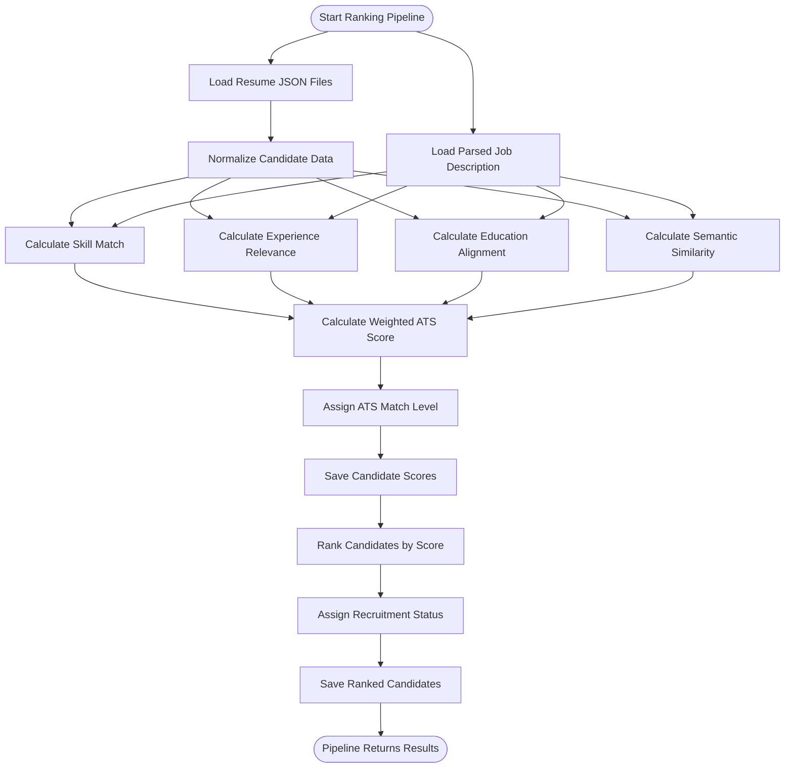
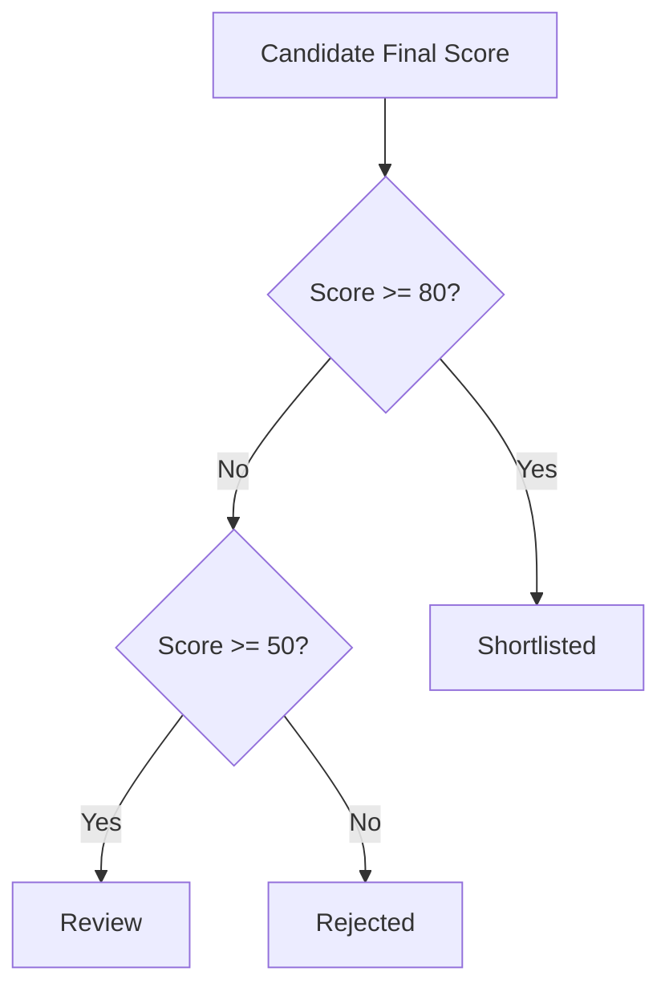
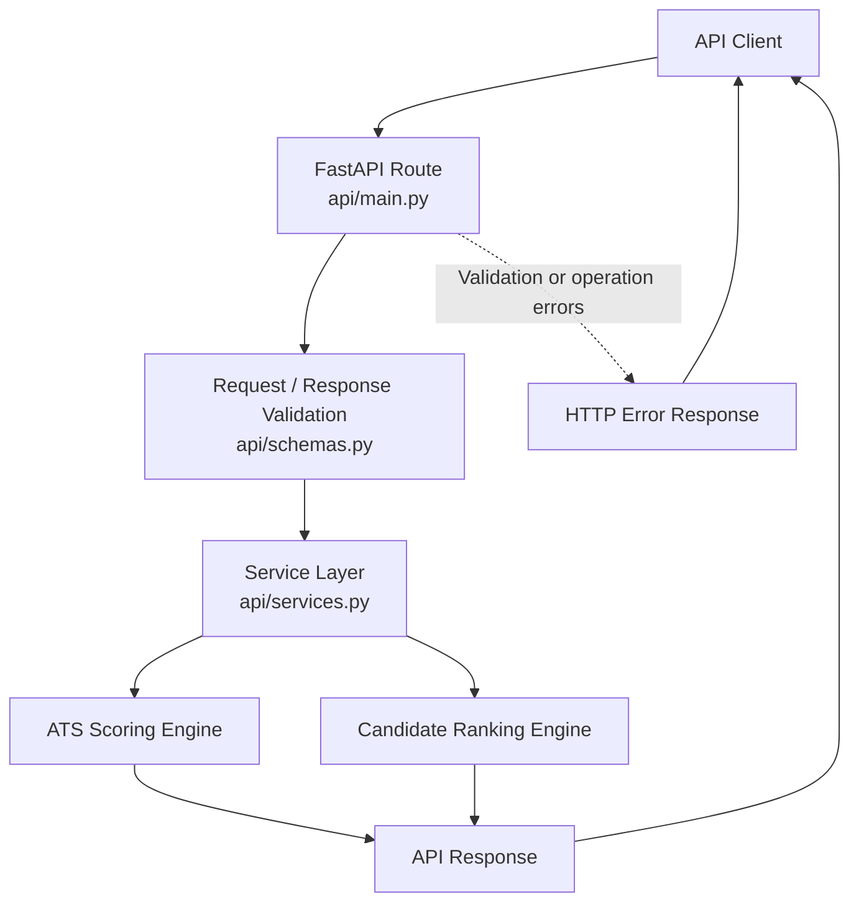

# Zecpath ATS — Architecture Diagrams

## 1. System Architecture

This diagram shows the major modules in the Zecpath ATS project and their responsibilities. The API provides access to selected scoring and ranking functionality, while the ranking pipeline operates directly on resume and job-description JSON files.

flowchart TB
    User["Client / Developer"]

    subgraph API["FastAPI Layer"]
        Main["api/main.py"]
        Schemas["api/schemas.py"]
        Services["api/services.py"]
        Logger["api/logger.py"]
    end

    subgraph Matching["Matching and Ranking"]
        ATS["ATS Scoring Engine"]
        Semantic["Semantic Matching Engine"]
        Ranking["Candidate Ranking Engine"]
        Pipeline["Candidate Ranking Pipeline"]
        Normalize["Candidate Normalization"]
    end

    subgraph Parsing["Resume and Job Description Processing"]
        ResumeParser["Resume Parser"]
        SkillParser["Skill Extraction"]
        ExperienceParser["Experience Parser"]
        EducationParser["Education Parser"]
        JDParser["Job Description Parser"]
    end

    subgraph Data["JSON Data"]
        Resumes["data/resumes/"]
        JDs["data/job_descriptions/"]
        Scores["candidate_scores.json"]
        Ranked["ranked_candidates.json"]
        Uploads["data/uploads/"]
    end

    User --> Main
    Main --> Schemas
    Main --> Services
    Main --> Logger

    Services --> ATS
    Services --> Ranking

    Pipeline --> Resumes
    Pipeline --> JDs
    Pipeline --> Normalize
    Pipeline --> ATS
    Pipeline --> Semantic
    Pipeline --> Ranking
    Pipeline --> Scores
    Ranking --> Ranked

    Resumes -. "Parsed by separate modules" .-> ResumeParser
    ResumeParser --> SkillParser
    ResumeParser --> ExperienceParser
    ResumeParser --> EducationParser
    JDs -. "Processed by separate module" .-> JDParser

    Main --> Uploads
```

**Implementation note:** The diagram groups modules by responsibility. It does not imply that the standalone parsing modules are automatically invoked by the ranking pipeline. The current API background-processing function is a placeholder, and its complete integration with the parsing, scoring, and ranking workflow remains future work.

## 2. Candidate Scoring and Ranking Workflow

The ranking pipeline reads structured resume and job-description data, computes component scores, generates final ATS scores, and ranks candidates.



### ATS score calculation

The final score is calculated from four normalized components:

```text
Final ATS Score =
(
    Skill Match × 0.30
  + Experience Relevance × 0.25
  + Education Alignment × 0.20
  + Semantic Similarity × 0.25
) × 100
```

### Semantic similarity calculation

The semantic matching engine combines three similarity values:

```text
Overall Semantic Similarity =
    Skills Similarity × 0.40
  + Experience Similarity × 0.35
  + Projects Similarity × 0.25
```

The engine uses the `all-MiniLM-L6-v2` sentence-transformer model and cosine similarity. Generated embeddings are cached using an LRU cache with a maximum of 512 entries.

### Candidate status assignment



The ATS match level and recruitment status are separate classifications. For example, a score of 70 is a **Good Match** and receives the recruitment status **Review**.

## 3. API Request Flow

The API layer uses FastAPI routes, Pydantic schemas, and service functions to expose selected ATS capabilities.



### API endpoint responsibilities

| Endpoint | Responsibility |
|---|---|
| `GET /` | Return API health information |
| `POST /resume/upload` | Validate and save an uploaded resume |
| `POST /resume/process` | Create a background job and return a job ID |
| `GET /resume/process/{job_id}` | Return the stored job status |
| `POST /resume/parse` | Validate supplied text and return it as parsed text |
| `POST /candidate/score` | Calculate a weighted ATS score |
| `POST /candidate/shortlist` | Rank candidates and assign recruitment statuses |

### Background resume processing: current state

The current `/resume/process` endpoint:

1. Validates the uploaded filename, extension, and file contents.
2. Saves the uploaded file under `data/uploads/`.
3. Creates a unique job ID.
4. Schedules `process_resume_job()` using FastAPI background tasks.
5. Returns the job ID and initial queued status.

The background function updates the job status and stores a placeholder result. It does **not** currently execute the complete resume parsing, normalization, matching, scoring, and ranking pipeline.

Job records are kept in an in-memory dictionary, so they do not persist across application restarts.

## 4. Architecture Design Principles

### Modularity

Parsing, semantic matching, scoring, ranking, and API responsibilities are separated into distinct modules.

### Explainable scoring

The ATS scoring engine returns a final score, match classification, component breakdown, and weights.

### Reusability

The API service layer delegates scoring and ranking to existing engine functions instead of duplicating their core calculations.

### Performance

The semantic matching engine caches generated embeddings to reduce repeated encoding work for identical text.

### Testability

The project contains automated tests for scoring, ranking, parsing, and other core modules.

### Future extensibility

The architecture can be extended by integrating the background-processing function with the existing parsing and matching modules, adding persistent job storage, and improving experience and education matching logic.

## 5. Diagram Maintenance

When the implementation changes:

1. Update the relevant module descriptions and connections.
2. Verify that every diagram reflects actual function calls and data flow.
3. Clearly label planned integrations as future work.
4. Update scoring formulas and thresholds when their implementation changes.
5. Keep API endpoint documentation synchronized with `api/main.py` and `api/schemas.py`.

These diagrams document the current architecture reviewed for Day 19 and should be updated alongside significant code changes.
